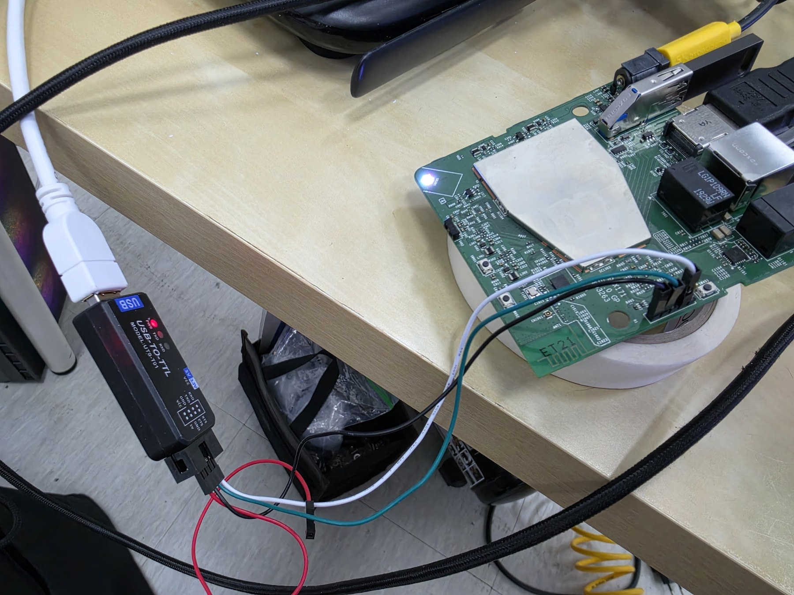

# BFX-AT100: Android 9에서 Android 12.1 기본 시스템으로 판올림

**당근에서 중고로 구매한 SK브로드밴드 BFX-AT100이 Android 9에 멈춰 있어, 기존 파티션을 유지하면서 Android 12.1 기반 AOSP/PHH GSI로 판올림한 개인 작업 기록과 보조 소스입니다.**

출발점은 Android 12 기기가 아닙니다. **Android 9 → Android 12 계열의 실제 OS 판올림**을 진행했습니다. 여기서 ‘기본 버전’은 B tv용 제조사 시스템 대신 사용한 **PHH v416 vanilla Android 12.1/API 32**를 뜻합니다. SKB 공식 Android 12 펌웨어를 성공적으로 설치한 결과나, 공식 Android TV 인증 제품 이미지를 배포하는 프로젝트가 아닙니다.

확인일: **2026-10-31**. 게임·에뮬레이터 설정은 이 저장소에 포함하지 않습니다.

**새 연결 수정:** USB RTL8821CU Wi-Fi의 검색·TV 기본 암호 입력·저장 네트워크 자동 복귀와 BMM-BA03의 홈·방향키·뒤로·숫자키 보정을 공개했습니다. LAN 없는 완전 전원 부팅, USB 재연결과 실제 리모컨 동작을 현장 수정본에서 확인했습니다. [지원 하드웨어·소스 빌드·적용·복구 안내](docs/connectivity.md)를 참고하세요. 이번 공개 재빌드는 오프라인 검증을 통과했으며, **기존 r1 ZIP에는 이 변경이 없습니다.**

**후속 리모컨·OTT 수정:** BMM-BA03이 부팅 60초 뒤 연결되면 순정 드라이버 전환이 빠지던 결함을 수정했습니다. 늦은 연결·재연결, 확인·음량키와 HDMI 음량 표시를 실물에서 확인했습니다. Netflix `-14`의 별도 원인과 영상·전체 화면 수동 우회, 실제 FHD 측정 및 재부팅 재발 한계는 [리모컨·HDMI·Netflix 검증 기록](docs/tv-playback.md)에 구분했습니다. **Netflix 부팅 초기 자동 화면 보정은 검증에 실패해 안정 수정으로 배포하지 않습니다.** 기존 r1 ZIP은 바뀌지 않습니다.

**유선랜은 하드웨어별 별도 작업이 필요합니다.** 확인한 BFX-AT100 내장 LAN의 결과이며, 다른 보드·리비전·USB 유선랜은 MAC/PHY·Device Tree·커널 드라이버·vendor 서비스와 DHCP 구성을 각각 확인해야 합니다. 무선랜도 확인한 USB ID/커널 조합에 한정합니다.

**후속 R3 결과:** 장시간 kernel wakelock 통계 읽기 고착을 보정한 개인화 현장 이미지에서 **60분·61회 검사와 정상 재부팅 2회**가 통과했습니다. Google 계정·ADB 인증 유지, Widevine L1 세션 생성·종료와 내부 PCM/HDMI 경로도 확인했습니다. [시험 결과·한계·공개 r1과의 차이](docs/runtime-validation.md)를 먼저 확인하세요. R3의 실제 TV 구독 재생·음성·완전 전원 부팅은 미검증입니다.

**설치용 이미지:** [Releases에서 r1 ZIP 다운로드](https://github.com/a77ila2000/SKB-BFX-AT100-ADB/releases/tag/bfx12.1-vanilla-20261029-r1) · [다운로드·자기 기기 검증·UART 설치·첫 설정 안내](docs/distribution.md). 개인정보와 ADB 키를 넣지 않은 실험 배포본이며, 원본 덤프가 아닙니다. SKB의 OTA 업로드 메뉴에 넣는 ZIP도 아닙니다. 배포용 재빌드 자체의 실기기 부팅은 미시험이며, 현장 개인화 이미지의 부팅 검증과 구분합니다.

**공개 r1 ZIP에는 후속 통계 보정·Google 통합·USB Wi-Fi·리모컨 보정이 없습니다.** main의 기본 이미지 빌더는 통계 보정을 포함하지만 새 연결 소스는 별도 빌드·통합이 필요합니다. 기존 릴리스 ZIP은 바뀌지 않으며, 개인화 현장 이미지의 시험 결과를 r1 ZIP의 결과로 해석하지 않습니다.



사진의 기판에는 UART 핀헤더가 이미 실장되어 있어, 점퍼 케이블로 **별도 납땜 없이** 연결했습니다. 기판 전체 사진과 신호별 연결표는 [설치 안내의 UART 연결 부분](docs/distribution.md)에 있습니다. 선 색깔 대신 기판·변환기의 신호명을 기준으로 연결합니다.

## 왜 이 작업을 했나

구매한 셋톱은 B tv 계약이 해지된 상태였고, 기존 화면에는 고객센터에 연락해 다시 이용하라는 해지 안내가 표시됐습니다. Android 9에 머물러 있는 이 기기에서 정상적인 B tv 서비스·업데이트 이용을 완료할 수 없어, 일반 Android 시스템으로 활용하는 방향을 택했습니다.

다만 **계약 해지 때문에 펌웨어 파일 자체가 전혀 다운로드되지 않았던 것은 아닙니다.** 실제 recovery에서는 동일 모델용 Android 12 업데이트의 다운로드와 전체 파일 서명 검증이 성공했습니다. 그 뒤 설치 약 24%에서 실패·재부팅이 반복됐고, UART로 확인한 직접 원인은 **구형 정적 파티션에서 `super` 동적 파티션으로의 전환 실패**였습니다. 해지 상태와 설치 실패의 기술적 원인을 구분해 기록합니다.

| 항목 | 출발 상태 | 실패한 공식 OTA의 대상 | 실제 적용 결과 |
|---|---|---|---|
| 시스템 | SKB Android 9 | SKB Android 12 | PHH vanilla Android 12.1 |
| API | 28 | 31 | 32 |
| 빌드/기반 | `PI.15.520.8-20200731` | `15.561.128-20260611` | PHH v416, `arm32_binder64-ab` |
| 파티션 | 개별 `system/vendor/product/odm` | `super` 안의 논리 파티션 요구 | 기존 정적 구조 유지 |
| 결과 | 해지 안내, 업데이트 반복 실패 | 동적 파티션 갱신 오류 25 | 실제 부팅·화면·유선 통신·PCM 소리 확인 |

## 공식 업데이트가 실패한 지점

```text
whole-file signature verified against RSA key 0
now upgrade from android 28 to S
upgrade from old android to new, need upgrade by two step.
else case, ota_zip_check() != 1
format: mke2fs failed (256) on /dev/block/by-name/metadata
DTB NOT changed...
open failed: /dev/block/by-name/super: No such file or directory
Failed to load dynamic partition metadata.
assert failed: update_dynamic_partitions(...)
error: 25
```

기존 recovery/파티션에서 새 구조로 옮기는 선행 단계가 이 시도에서 실행되지 않았습니다. ‘Android 9가 너무 오래돼서’라는 추측만으로 결론내린 것이 아니며, **특정 중간 버전을 반드시 설치해야 한다거나 Android 10·11을 차례로 거쳐야 한다는 절차는 확인하지 못했습니다.** 자세한 구분은 [공식 OTA 실패 분석](docs/ota-failure.md)을 참고하세요.

## 어떤 방식으로 Android 12를 올렸나

1. 원래 Android 9 기기의 eMMC와 파티션을 읽어 백업하고 별도 해시 검증을 했습니다.
2. 실제 32비트 userspace와 Binder 프로토콜을 확인해 PHH v416 **ARM32/Binder64 vanilla** 이미지를 선택했습니다.
3. 구형 kernel/vendor와 정적 파티션을 유지하고, 새 GSI의 `system`·`product`·`system_ext`가 올바르게 보이도록 fstab과 부팅 인자를 조정했습니다.
4. system 이미지와 그에 맞는 vbmeta를 만들고 AVB 서명·해시 트리·변경하지 않은 파티션 기술자를 검증한 뒤 적용했습니다.
5. 첫 부팅의 SystemUI·구형 앱 충돌, 고정 IP 저장 후 부팅 반복, 부팅 애니메이션과 오디오 HAL의 오류 경로를 조사하고 수정했습니다.
6. USB를 뺀 상태에서 전원을 완전히 분리·재연결하고 실제 TV 화면과 소리를 확인했습니다.

관측한 기기의 공개 AOSP 시험 키 수용 조건을 이용한 장치별 작업입니다. **AVB green은 이 수정 이미지의 검증 통과를 뜻하며 제조사 정식 펌웨어·잠금 해제 성공·일반 기기에 대한 범용 설치 보증을 뜻하지 않습니다.**

## 문서와 소스

- [설치 구조·작업 순서·복구 범위](docs/install.md)
- [배포 이미지로 설치하기: 검증부터 첫 부팅까지](docs/distribution.md)
- [공식 OTA의 24% 실패와 파티션 차이](docs/ota-failure.md)
- [호환성 수정 및 실제 검증 범위](docs/compatibility.md)
- [후속 R3: 60분 반복·재부팅·Google·DRM 검증](docs/runtime-validation.md)
- [USB Wi-Fi·TV 리모컨: 지원 범위, 소스 빌드와 설치 후 시험](docs/connectivity.md)
- [순정 리모컨·HDMI 음량·Netflix 영상과 전체 화면: 확인한 결과와 제약](docs/tv-playback.md)
- [소스 사용법·공개 범위·개인정보 제외 기준](docs/source-and-privacy.md)
- [기존 SKB Android 9/12의 ADB 진입 안내](docs/adb-stock.md)
- [기존 ADB 분석 근거](docs/verification.md)

Git 저장소에는 **오프라인 이미지 구성·검증 도구 및 진단 보조 코드**를, Releases에는 **개인정보를 제거한 설치용 system/vbmeta ZIP**을 제공합니다. 기기의 flash를 자동으로 덮어쓰는 설치기는 제공하지 않습니다. 제조사 OTA 전체·원본 APK·eMMC 덤프·ADB 키·개인 정보는 배포하지 않습니다.

## 확인된 결과와 한계

- Android 12 계열/API 32 부팅 완료와 HDMI 화면, 인증된 ADB, DHCP 유선 통신을 확인했습니다.
- 초기 현장 수정본에서 USB 없는 완전 전원 부팅과 실제 TV의 PCM HDMI 소리를 확인했습니다. 후속 R3에서 새로 한 전원 분리 시험은 아닙니다.
- 오래된 GPU/vendor의 모든 기능이나 장시간 안정성을 보증하지 않습니다.
- 공개 r1 vanilla에는 Google 앱이 없습니다. 후속 개인화 R3에서는 Google 시스템 통합·계정 유지·스토어와 DRM L1 세션을 확인했지만, 실제 음성·OTT 구독 재생·제조사 인증은 검증하지 않았습니다.
- 확인한 내장 무선 칩은 Bluetooth 전용입니다. 후속 수정에서 **외장 USB RTL8821CU**로 Wi-Fi 검색·접속·LAN 없는 자동 재연결을 확인했습니다. 모든 USB 무선랜 지원을 뜻하지 않습니다.
- 기반 보안 패치는 **2022-07-05**입니다. 설치 작업일과 시스템 보안 패치 날짜는 다릅니다.

## 추후 Android 12 셋톱 작업 계획

추후 **제조사 Android 12가 이미 설치된 셋톱박스**를 별도로 확보하면, 해당 기기의 원본 백업·파티션·recovery·AVB 구조부터 확인해 별도 작업으로 진행할 예정입니다. 현재 공개 내용은 **Android 9 상태였던 BFX-AT100을 Android 12.1 vanilla로 올린 작업**입니다. Android 12 상태의 다른 기기를 확보하거나 그 기기에 대한 설치 검증을 마쳤다는 뜻은 아닙니다. 새 대상의 적용 조건과 결과는 확보 후 구분해 기록하겠습니다.

## 기반 프로젝트

- [PHH AOSP 12.1 v416](https://github.com/phhusson/treble_experimentations/releases/tag/v416)
- [AOSP GSI](https://source.android.com/docs/core/tests/vts/gsi)
- [AOSP non-A/B 동적 파티션 OTA](https://source.android.com/docs/core/ota/dynamic_partitions/nonab)
- [AOSP Android Verified Boot](https://android.googlesource.com/platform/external/avb/+/refs/tags/android-12.0.0_r34/README.md)
